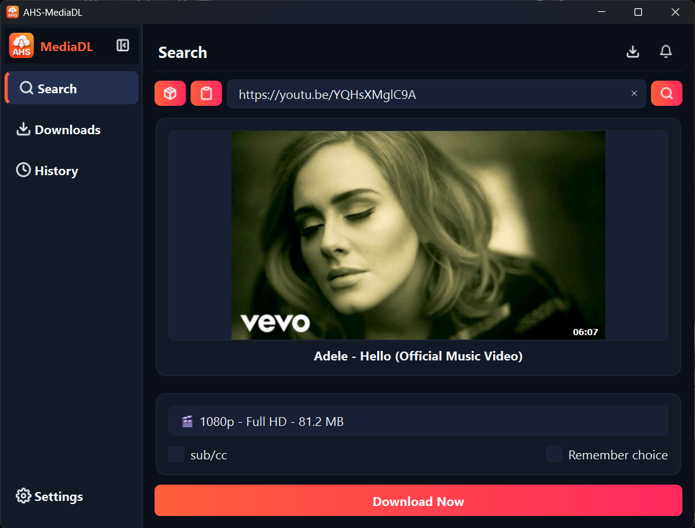
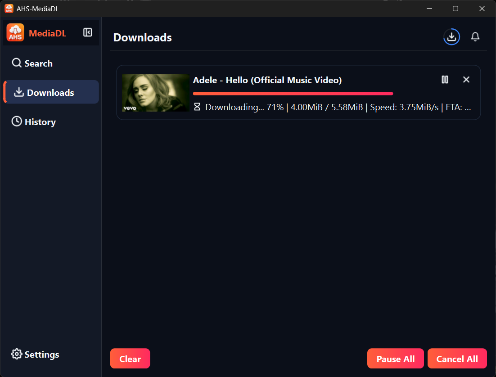
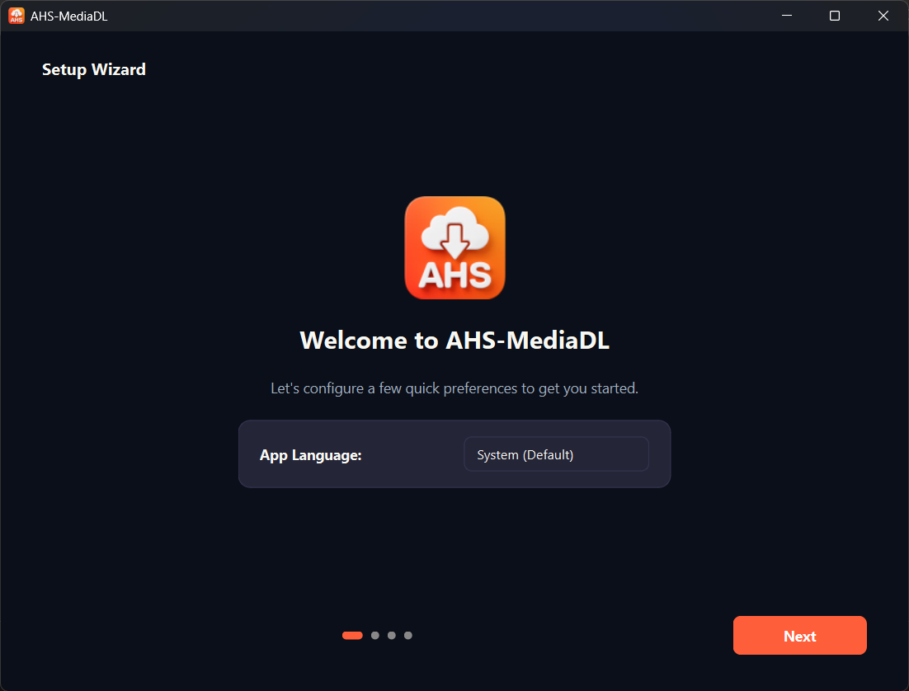
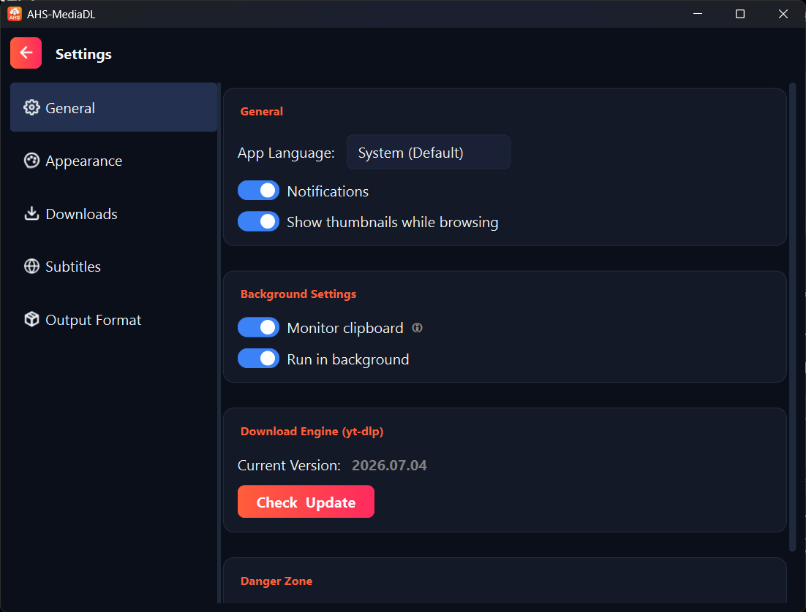
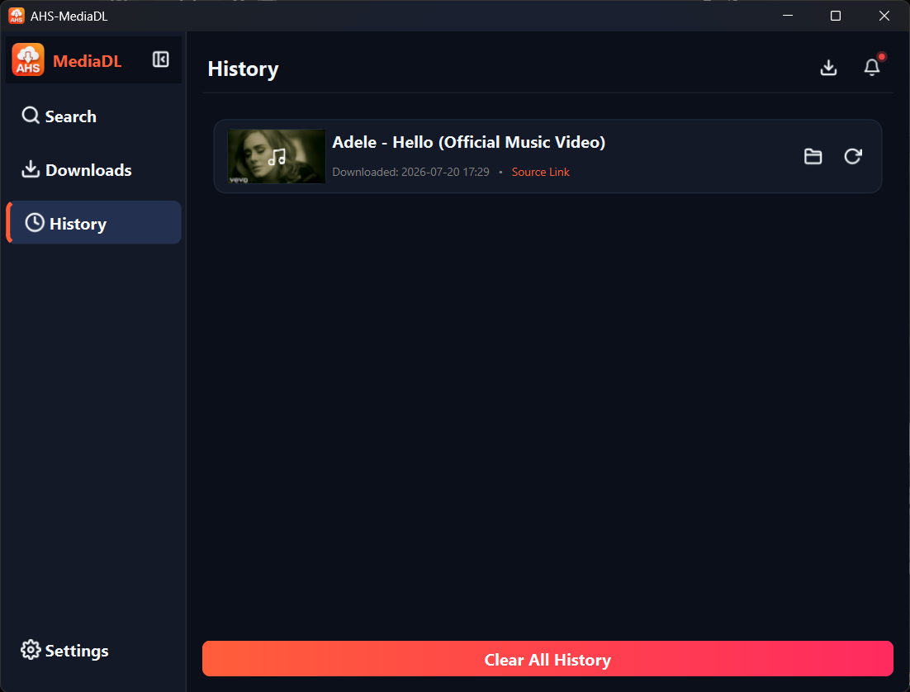
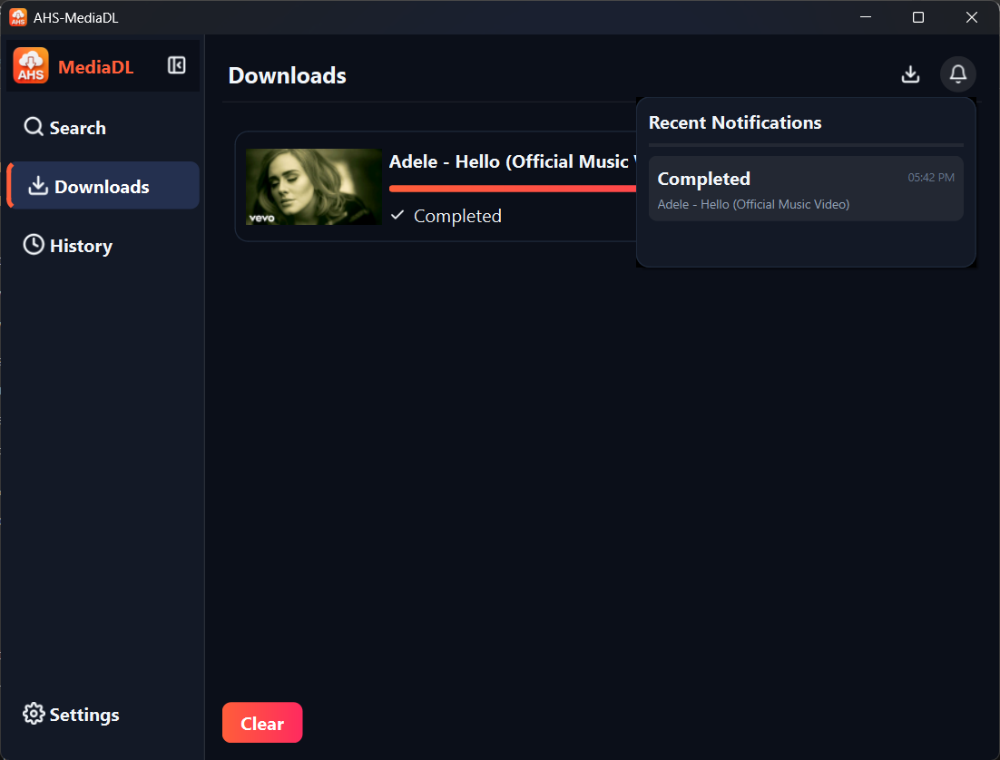

# AHS-MediaDL

<p align="center">
  
</p>

<p align="center">
  <strong>تطبيق سطح مكتب حديث ومتعدد المنصات لتحميل الفيديوهات والصوتيات، مبني باستخدام Python وPyQt6 وyt-dlp وFFmpeg.</strong>
</p>

<p align="center">
  
  
  
  
  
</p>

---

## 📖 نبذة عن المشروع

**AHS-MediaDL** هو تطبيق سطح مكتب حديث لتحميل وإدارة الفيديوهات والملفات الصوتية، تم تطويره باستخدام **Python وPyQt6**، بالاعتماد على **yt-dlp** كمحرك أساسي للتحميل و**FFmpeg** لمعالجة الوسائط وتحويلها.

يوفر التطبيق واجهة رسومية متكاملة وسهلة الاستخدام تجمع بين البحث عن المحتوى، فحص الروابط، اختيار الجودة والصيغة، تحميل قوائم التشغيل، إدارة طابور التنزيلات، استخراج الصوت، التعامل مع الترجمات، وسجل التحميلات، بالإضافة إلى مجموعة واسعة من خيارات التخصيص والتكامل مع نظام التشغيل.

تم تصميم التطبيق ليقدم تجربة استخدام حديثة تجمع بين قوة أدوات تحميل الوسائط المتقدمة وسهولة استخدام تطبيقات سطح المكتب التقليدية، مع التركيز على تنظيم الكود، قابلية التوسع، وتحسين تجربة المستخدم.

---

## 📋 جدول المحتويات

- [⚡ أهم المميزات](#-أهم-المميزات)
- [🖼️ صور من التطبيق](#️-صور-من-التطبيق)
- [🔄 كيف يعمل التطبيق؟](#-كيف-يعمل-التطبيق)
- [📦 الصيغ والجودات المدعومة](#-الصيغ-والجودات-المدعومة)
- [🌐 المنصات المدعومة](#-المنصات-المدعومة)
- [🔐 الإعدادات والجلسات المسجلة](#-الإعدادات-والجلسات-المسجلة)
- [📥 طرق التنزيل والتثبيت](#-طرق-التنزيل-والتثبيت)
- [🚀 طريقة الاستخدام](#-طريقة-الاستخدام)
- [🏗️ بنية المشروع](#️-بنية-المشروع)
- [📁 هيكل المشروع](#-هيكل-المشروع)
- [🛠️ التقنيات المستخدمة](#️-التقنيات-المستخدمة)
- [🔮 أفكار لتطوير المشروع مستقبلًا](#-أفكار-لتطوير-المشروع-مستقبلًا)
- [🤝 المساهمة](#-المساهمة)
- [📜 الترخيص](#-الترخيص)
- [🙏 شكر وتقدير](#-شكر-وتقدير)
- [💡 عن المشروع](#-عن-المشروع)

---

## ⚡ أهم المميزات

### 📥 تحميل الفيديوهات والصوتيات

- **دعم الجودة العالية**: تحميل الفيديوهات بدقات تبدأ من 360p وتصل إلى 4K و8K حسب الجودة المتوفرة من المصدر.
- **استخراج الصوت**: استخراج الصوت وتحويله مباشرة إلى صيغ مثل MP3 وM4A.
- **دمج الفيديو والصوت تلقائيًا**: استخدام FFmpeg لدمج مسارات الفيديو والصوت المنفصلة عند الحاجة.
- **دعم صيغ متعددة**: اختيار صيغ الفيديو والصوت المتاحة.
- **دعم الترجمات**: اختيار وتحميل الترجمات المتوفرة مع الوسائط.

### 🔍 البحث

- **البحث داخل YouTube**: البحث عن الفيديوهات مباشرة من داخل التطبيق دون الحاجة إلى فتح المتصفح.
- **عرض النتائج بطريقة منظمة**: عرض النتائج في بطاقات تحتوي على الصورة المصغرة، والعنوان، واسم القناة، ومدة الفيديو.
- **تحميل المزيد من النتائج**: إمكانية جلب نتائج إضافية بشكل ديناميكي.
- **التحميل المباشر**: بدء عملية التحميل مباشرة من نتائج البحث.
- **توفير استهلاك الإنترنت**: إمكانية تعطيل تحميل الصور المصغرة لتقليل استهلاك البيانات.

### 📊 إدارة التحميلات

- **التحميلات المتزامنة**: التحكم في عدد التحميلات التي تعمل في نفس الوقت من 1 وحتى 20 تحميلًا.
- **إدارة قائمة الانتظار**: التحكم في مهام التحميل الفردية أو جميع المهام معًا.
- **الإيقاف والاستئناف**: إيقاف التحميل مؤقتًا واستكماله لاحقًا.
- **الإلغاء وإعادة المحاولة**: إلغاء التحميلات أو إعادة محاولة المهام التي فشلت.
- **متابعة مباشرة**: عرض نسبة التحميل والسرعة وحجم الملف والوقت المتبقي المتوقع.
- **شريط تقدم ذكي وتصاعدي**: توزيع نسبي حقيقي لمراحل التحميل (الترجمة 0-1%، الفيديو 1-85%، الصوت 86-99%، المعالجة 99-100%) لضمان حركة سلسة ومنع ارتداد الشريط.
- **تحديد سرعة التحميل**: تحديد أقصى سرعة للتحميل باستخدام قيم جاهزة أو قيمة مخصصة.
- **منع استبدال الملفات**: التعامل تلقائيًا مع الملفات التي تحمل الاسم نفسه وإضافة رقم متسلسل للاسم.

### 📜 قوائم التشغيل والتحميلات الجماعية

- **فحص قوائم التشغيل**: عرض محتويات قائمة التشغيل وإتاحة اختيار عناصر محددة أو تحميل القائمة بالكامل.
- **تحديد الكل / إلغاء تحديد الكل**: تحديد أو إلغاء تحديد عناصر متعددة بسرعة.
- **تحميل عدة روابط معًا**: إضافة مجموعة من الروابط داخل نافذة مخصصة وتحميلها كحزمة واحدة.
- **التحكم في عدد فيديوهات Mix**: تحديد حد أقصى لعدد الفيديوهات التي يمكن معالجتها من بعض أنواع روابط Mix أو القوائم.

### 💬 الترجمات

- **تصنيف الترجمات** إلى:
  - ترجمات يدوية.
  - ترجمات تلقائية باللغة الأصلية.
  - ترجمات تلقائية مترجمة.
- **إظهار حالة الترجمة بصريًا**: توضيح عدم توفر الترجمة للمستخدم قبل بدء التحميل.
- **دعم صيغ الترجمة**: `.vtt` و`.srt`.
- **معالجة الترجمات**: إمكانية التعامل مع الترجمات كجزء من عملية تحميل الوسائط أو حفظها كملفات منفصلة حسب إعدادات التحميل.

### 📂 سجل التحميلات

- **البحث والتصفية**: البحث في سجل التحميلات باستخدام اسم الفيديو أو اسم القناة.
- **فتح الملف**: فتح الملف الذي تم تحميله باستخدام البرنامج الافتراضي في النظام.
- **فتح المجلد**: فتح المجلد الذي يحتوي على الملف.
- **إعادة التحميل**: إعادة تحميل العناصر السابقة.
- **إدارة السجل**: حذف عناصر محددة أو مسح السجل.

### 🎨 الثيمات والتخصيص

- **أوضاع المظهر**:
  - الوضع الداكن.
  - الوضع الفاتح.
  - الوضع التلقائي حسب النظام.
- **ألوان مميزة**: اختيار اللون البرتقالي أو الأزرق أو البنفسجي أو الأخضر.
- **تخصيص الخط**: اختيار أي خط مثبت على النظام.
- **تغيير حجم الخط**.
- **تغيير مقياس الواجهة** من 100% وحتى 200%.
- **حركات وانتقالات سلسة** لتحسين تجربة الاستخدام.

### 🧭 الإعداد الأولي

يحتوي التطبيق على معالج إعداد مبدئي مكون من أربع خطوات يساعد المستخدم على إعداد التطبيق عند تشغيله لأول مرة.

يمكن من خلاله إعداد:

- لغة التطبيق.
- المظهر.
- مكان حفظ الملفات.
- إعدادات التشغيل في الخلفية.

كما يحتوي التطبيق على آلية آمنة لإعادة تشغيل التطبيق عند الحاجة بعد تغيير اللغة لضمان تحميل الواجهة الجديدة بشكل صحيح.

### 🔔 الإشعارات

- **إشعارات منبثقة تفاعلية** لأحداث التحميل وحالة المهام.
- **درج إشعارات** لعرض الإشعارات السابقة.
- **مؤشر للإشعارات غير المقروءة**.
- **إدارة الإشعارات** وعرضها ومسحها.

### 🖥️ التكامل مع نظام التشغيل

- **System Tray**: تشغيل التطبيق في منطقة النظام بجانب الساعة.
- **العمل في الخلفية وتوفير الرام**: استمرار التطبيق في الخلفية مع تقليص استهلاك الذاكرة إلى **3-4 ميجابايت فقط** (Ultra-low RAM Footprint).
- **مراقبة الحافظة الذكية**: اكتشاف روابط الوسائط المنسوخة تلقائياً في الخلفية وإرسال تنبيهات تفاعلية لتحميلها.
- **إدارة المحركات التلقائية (Auto-Tooling)**: فحص واكتشاف أدوات FFmpeg و yt-dlp في مجلد `bin` أو النظام، مع نافذة تجهيز تلقائية عند الحاجة، وحماية ضد تعارض قفل الملفات في ويندوز.
- **منع تشغيل أكثر من نسخة**: استخدام IPC لمنع تشغيل أكثر من نسخة من التطبيق في الوقت نفسه وتحويل الطلبات الجديدة إلى النسخة المفتوحة.
- **تشغيل التطبيق مع بدء Windows**: دعم إعداد اختصار لتشغيل التطبيق عند بدء تشغيل النظام.

### 🌐 تعدد اللغات

- **دعم العربية والإنجليزية**.
- **تغيير اتجاه الواجهة تلقائيًا** بين RTL وLTR.
- **تغيير لغة التطبيق من الإعدادات**.
- **إعادة تشغيل آمنة عند الحاجة** لتطبيق تغييرات اللغة بشكل صحيح.

---

## 🖼️ صور من التطبيق

| البحث والنتائج | قائمة التحميلات |
| :---: | :---: |
|  |  |

| معالج الإعداد الأولي | الإعدادات والتخصيص |
| :---: | :---: |
|  |  |

| سجل التحميلات | مركز الإشعارات |
| :---: | :---: |
|  |  |

---

## 🔄 كيف يعمل التطبيق؟

```text
┌─────────────────┐     ┌──────────────────────┐     ┌──────────────────────┐
│  Input URL or   │ ──> │   InfoFetcherThread  │ ──> │  Quality & Format    │
│  Search Query   │     │   (yt-dlp Inspection)│     │   Selection Dialog   │
└─────────────────┘     └──────────────────────┘     └──────────────────────┘
                                                                │
                                                                v
┌─────────────────┐     ┌──────────────────────┐     ┌──────────────────────┐
│  File Saved /   │ <── │    FFmpeg Handler    │ <── │    DownloadWorker    │
│ Registered in   │     │   (Merge & Convert)  │     │   (Progress & ETA)   │
│     History     │     └──────────────────────┘     └──────────────────────┘
└─────────────────┘
```

1. **إدخال الرابط أو البحث**: يدخل المستخدم رابط فيديو أو قائمة تشغيل، أو يبحث عن فيديو من خلال التطبيق.
2. **فحص الرابط**: يقوم `InfoFetcherThread` بفحص الرابط في الخلفية باستخدام `yt-dlp` واستخراج البيانات والجودات والترجمات المتاحة.
3. **اختيار الجودة**: يختار المستخدم جودة الفيديو أو صيغة الصوت أو خيارات الترجمة.
4. **إضافة إلى قائمة الانتظار**: تتم إضافة المهمة إلى `DownloadManager` وفقًا لعدد التحميلات المتزامنة المحدد.
5. **التحميل**: يتولى `DownloadWorker` تنفيذ عملية التحميل مع تحديث نسبة التقدم والسرعة والوقت المتبقي.
6. **المعالجة**: يتولى `FFmpegHandler` عمليات دمج الفيديو والصوت أو تحويل الصوت عند الحاجة.
7. **اكتمال التحميل**: تتم إضافة الملف إلى سجل التحميلات وإرسال إشعار للمستخدم.

---

## 📦 الصيغ والجودات المدعومة

> تعتمد الجودات والصيغ المتاحة فعليًا على الفيديو المصدر والإمكانيات التي يوفرها محرك `yt-dlp`.

| الفئة | الخيارات والصيغ |
| :--- | :--- |
| **جودة الفيديو** | حتى 8K (4320p)، 4K (2160p)، 2K (1440p)، 1080p60، 1080p، 720p60، 720p، 480p، 360p، 240p |
| **صيغ الفيديو** | MP4، MKV، WebM، MOV |
| **استخراج الصوت** | MP3، M4A، أفضل جودة صوت أصلية |
| **الترجمات** | يدوية، تلقائية أصلية، تلقائية مترجمة |
| **ملفات الترجمة** | `.vtt`، `.srt` |

---

## 🌐 المنصات المدعومة

يعتمد AHS-MediaDL على **yt-dlp** كمحرك أساسي لاستخراج الوسائط وتحميلها.

وبالتالي، يستطيع التطبيق التعامل مع المنصات والمواقع التي يدعمها إصدار `yt-dlp` المثبت، مع اختلاف التوافق حسب حالة كل منصة والقيود المفروضة عليها.

ومن أمثلة المنصات التي يمكن التعامل معها:

- **منصات الفيديو**: YouTube وVimeo وDailymotion وTwitch وغيرها.
- **منصات التواصل الاجتماعي**: Facebook وInstagram وTikTok وTwitter/X وThreads وغيرها.
- **منصات الصوت**: SoundCloud وBandcamp وغيرها.

> يعتمد توافق المنصات على إصدار `yt-dlp` المستخدم. يوفر AHS-MediaDL خيارًا لتحديث محرك `yt-dlp` من داخل صفحة الإعدادات.

---

## 🔐 الإعدادات والجلسات المسجلة

### استخدام Cookies للوصول إلى المحتوى الذي يتطلب تسجيل الدخول

يدعم AHS-MediaDL تمرير ملفات تعريف الارتباط إلى `yt-dlp` عند الحاجة للوصول إلى محتوى يتطلب جلسة تسجيل دخول موجودة بالفعل.

- **استيراد Cookies من المتصفح**: دعم استيراد Cookies من متصفحات مدعومة مثل Chrome وFirefox وEdge وBrave وOpera وVivaldi وSafari.
- **ملف Cookies مخصص**: إمكانية استخدام ملف `cookies.txt` بتنسيق Netscape.
- **اختيار مصدر Cookies**: اختيار عدم استخدام Cookies أو استخدام Cookies من المتصفح أو استخدام ملف مخصص.

> يجب استخدام Cookies الخاصة بحساباتك أو الحسابات التي تملك إذنًا باستخدامها فقط.

---

## 📥 طرق التنزيل والتثبيت

يوفر مشروع **AHS-MediaDL** طريقتين لتشغيله على جهازك حسب رغبتك:

### 🚀 الخيار الأول: تحميل النسخة الجاهزة (Windows)

إذا كنت لا ترغب في التعامل مع الأكواد البرمجية وتثبيت متطلبات Python، يمكنك تحميل النسخة الجاهزة مباشرة من صفحة **GitHub Releases**.

**[تحميل أحدث نسخة جاهزة من GitHub Releases](https://github.com/AHS-Official/AHS-MediaDL/releases)**

بعد تحميل النسخة، اتبع التعليمات الموجودة في صفحة الإصدار لتثبيت وتشغيل التطبيق.

> **ملاحظة:** النسخة الجاهزة مخصصة حاليًا لنظام Windows.

---

### 🛠️ الخيار الثاني: التشغيل من الكود المصدري (جميع الأنظمة)

إذا كنت ترغب في تشغيل التطبيق من الكود المصدري أو تطويره، يمكنك اتباع خطوات التثبيت التالية:

### المتطلبات الأساسية

- **Python**: الإصدار 3.10 أو أحدث
- **FFmpeg**: مطلوب لدمج مسارات الفيديو والصوت وتحويل الملفات الصوتية.

### 1. استنساخ المستودع

```bash
git clone https://github.com/AHS-Official/AHS-MediaDL.git
cd AHS-MediaDL
```

### 2. إنشاء بيئة افتراضية

#### Linux / macOS

```bash
python3 -m venv .venv
source .venv/bin/activate
```

#### Windows

```powershell
python -m venv .venv
.venv\Scripts\activate
```

### 3. تثبيت الاعتمادات

```bash
pip install --upgrade pip
pip install -r requirements.txt
```

### 4. إعداد FFmpeg

يمكن للتطبيق العثور على FFmpeg من خلال أحد الخيارات التالية:

#### System PATH

تثبيت FFmpeg وإضافة `ffmpeg` و`ffprobe` إلى متغير PATH في النظام.

#### الوضع المحمول

يمكن وضع ملفات FFmpeg المطلوبة داخل مجلد `bin/` في مجلد المشروع إذا كان ذلك مدعومًا من إعدادات المشروع الحالية.

### 5. تشغيل التطبيق

```bash
python main.py
```

---

## 🚀 طريقة الاستخدام

### عند التشغيل لأول مرة

قم بإكمال معالج الإعداد المكون من أربع خطوات لاختيار:

- لغة التطبيق.
- الثيم.
- مكان حفظ الملفات.
- إعدادات التشغيل في الخلفية.

### التحميل عن طريق الرابط

1. انسخ رابط الوسائط وضعه في شريط البحث.
2. اضغط `Enter` أو ابدأ عملية الفحص.
3. اختر جودة الفيديو أو صيغة الصوت وخيارات الترجمة.
4. ابدأ التحميل.
5. تابع عملية التحميل من صفحة التحميلات.

### التحميل عن طريق البحث

1. اكتب كلمات البحث في شريط البحث.
2. اضغط `Enter`.
3. تصفح نتائج البحث.
4. اختر الفيديو المطلوب.
5. حدد الجودة والصيغة.
6. ابدأ التحميل.

### إدارة التحميلات

يمكنك من خلال صفحة التحميلات:

- متابعة التحميلات النشطة.
- مشاهدة نسبة التقدم والسرعة والوقت المتبقي.
- إيقاف واستئناف التحميلات.
- إلغاء المهام.
- إعادة محاولة التحميلات الفاشلة.
- التحكم في عدة تحميلات في الوقت نفسه.

### إدارة سجل التحميلات

يمكنك من خلال صفحة السجل:

- البحث في الملفات التي تم تحميلها.
- تصفية النتائج.
- فتح الملفات.
- فتح المجلدات التي تحتوي عليها.
- إعادة تحميل الملفات السابقة.
- حذف عناصر من السجل.

---

## 🏗️ بنية المشروع

يعتمد AHS-MediaDL على بنية برمجية modular architecture تهدف إلى فصل المسؤوليات وتنظيم الكود وجعل المشروع أسهل في الصيانة والتطوير.

```text
بنية AHS-MediaDL
│
├── Core Layer
│   └── Workers الخاصة بـ yt-dlp والتعامل مع FFmpeg
│
├── Services Layer
│   └── الخدمات المسؤولة عن تنسيق العمليات المختلفة
│
├── Managers Layer
│   └── إدارة حالة التطبيق والإعدادات والسجل وقائمة التحميلات
│
├── GUI Layer
│   └── واجهة PyQt6 والصفحات والمكونات والنوافذ
│
└── Utils Layer
    └── الترجمة والثيمات والتنسيقات والأدوات المساعدة
```

### `core/`

تحتوي على المكونات منخفضة المستوى المسؤولة عن التعامل مع أدوات الوسائط الخارجية.

مثل:

- `DownloadWorker`
- `InfoFetcherThread`
- `FFmpegHandler`

وتتعامل هذه المكونات مع العمليات التي تعمل في الخلفية، وفحص الوسائط، والتحميل، ومتابعة التقدم، والمعالجة بعد التحميل.

### `services/`

تحتوي على طبقة الخدمات التي تعمل كوسيط بين واجهة المستخدم والمكونات الداخلية للتطبيق، مما يساعد على فصل منطق الواجهة عن العمليات الأساسية.

### `managers/`

تتولى إدارة حالة التطبيق والبيانات المختلفة، مثل:

- طابور وقائمة التحميلات.
- فحص وإدارة وتنزيل المحركات (FFmpeg & yt-dlp).
- حفظ واسترجاع الإعدادات.
- سجل التحميلات وقاعدة البيانات (SQLite).
- إشعارات النظام.
- سرعة وحالة الشبكة.
- التكامل مع نظام التشغيل والثيمات.

### `gui/`

تحتوي على واجهة المستخدم المبنية باستخدام PyQt6، وتشمل:

- النافذة الرئيسية.
- البحث وفحص الروابط.
- التحميلات النشطة.
- سجل التحميلات.
- الإعدادات.
- معالج الإعداد الأولي.
- المكونات المخصصة.
- النوافذ المنبثقة.

### `utils/`

تحتوي على الأدوات المشتركة التي يستخدمها التطبيق، مثل:

- الترجمة.
- الثيمات.
- تنسيقات QSS.
- التعامل مع المسارات.
- تنسيق البيانات.
- معالجة الأيقونات.
- الوظائف المساعدة.

---

## 📁 هيكل المشروع

```text
AHS-MediaDL/
├── assets/                         # الأيقونات والرسومات
│   ├── icon.ico                    # أيقونة التطبيق الرئيسية (شعار السحابة)
│   └── icons/                      # أيقونات SVG المتوافقة مع الثيمات وتغيرات الشبكة
│
├── core/                           # التكامل مع محركات التحميل والمعالجة
│   ├── downloader.py               # Worker التحميل، نسب التقدم الذكية (0-100%)، وخطافات yt-dlp
│   └── ffmpeg_handler.py           # معالجة ودمج الوسائط واستخراج الصوت بـ FFmpeg
│
├── data/                           # البيانات المحلية والتخزين
│   ├── history.db                  # قاعدة بيانات سجل التحميلات (SQLite WAL)
│   ├── settings.json               # إعدادات المستخدم والتفضيلات
│   └── thumbnails/                 # ذاكرة التخزين المؤقت للصور المصغرة
│
├── docs/                           # وثائق وصور المعاينة
│   └── screenshots/                # لقطات شاشة لواجهات التطبيق
│
├── gui/                            # واجهة المستخدم المبنية بـ PyQt6
│   ├── main_window.py              # النافذة الرئيسية والتنقل وSystem Tray ومراقبة الحافظة
│   ├── components/                 # مكونات الواجهة القابلة لإعادة الاستخدام
│   │   ├── buttons.py              # الأزرار المتفاعلة وأيقونة مؤشر الشبكة
│   │   ├── cards.py                # بطاقات التحميل التفاعلية وشريط التقدم
│   │   ├── common.py               # المكونات الرسومية المشتركة
│   │   ├── media_panels.py         # لوحات فحص الفيديو وقوائم التشغيل
│   │   └── dialogs/                # النوافذ المنبثقة والاختيارات
│   │       ├── download_dialogs.py # نوافذ اختيار الجودات وتجميع القوائم
│   │       ├── packages_dialog.py  # نافذة صندوق مجمع الروابط
│   │       ├── popups.py           # نوافذ الإشعارات وإحصائيات الشبكة وToast
│   │       └── setup_dialog.py     # معالج تجهيز وتنزيل الأدوات (FFmpeg & yt-dlp)
│   │
│   └── pages/                      # الصفحات الرئيسية
│       ├── downloads_page.py       # صفحة إدارة ومتابعة التحميلات النشطة
│       ├── history_page.py         # صفحة السجل والبحث والعمليات على الملفات
│       ├── onboarding_page.py      # معالج الترحيب والضبط الأولي (Onboarding)
│       ├── search_page.py          # صفحة البحث المباشر في يوتيوب وفحص الروابط
│       └── settings_page.py        # صفحة الإعدادات، الثيمات، وإدارة وتحديث المحركات
│
├── managers/                       # مدراء حالة النظام والبيانات
│   ├── binary_manager.py           # فحص واكتشاف وتنزيل وتحديث أدوات FFmpeg و yt-dlp
│   ├── download_manager.py         # إدارة طابور التنزيل والتحميل المتزامن
│   ├── history_manager.py          # إدارة وحفظ السجل عبر SQLite مع دعم الترحيل
│   ├── network_manager.py          # مراقبة الاتصال بالإنترنت وحساب السرعة اللحظية
│   ├── notification_manager.py     # إدارة وعرض إشعارات النظام وصندوق التنبيهات
│   ├── settings_manager.py         # حفظ وإدارة الإعدادات مع الحماية والنسخ الاحتياطي
│   ├── system_manager.py           # التكامل مع ويندوز ولينكس (بروتوكولات واختصارات وبدء التشغيل)
│   └── ui_manager.py               # إدارة تناسق الواجهة والألوان والثيمات
│
├── services/                       # الخدمات ومحركات الاستخراج
│   └── yt_dlp_service.py           # البحث، فحص الروابط، وإدارة الجلسات والكوكيز
│
├── utils/                          # الأدوات المساعدة للنظام
│   ├── helpers.py                  # دوال المسارات والموارد المحسنة لـ Nuitka وتفريغ الرام
│   ├── logger.py                   # تسجيل وحفظ الأخطاء مع التدوير التلقائي (Rotating Log)
│   ├── single_instance.py          # قفل النسخة الواحدة وIPC وإدارة الإقلاع
│   ├── system_integration.py       # تكامل النظام وحقن المسارات
│   ├── theme.py                    # تنسيقات الواجهة المتقدمة (QSS) ونظام الألوان
│   └── locales/                    # نظام اللغات والترجمة (عربي وإنجليزي)
│       ├── strings_ar.py           # نصوص الواجهة العربية
│       ├── strings_en.py           # نصوص الواجهة الإنجليزية
│       └── __init__.py             # محرك الترجمة الديناميكي tr()
│
├── main.py                         # نقطة الانطلاق الأساسية للتطبيق
├── nuitka_build_command.md         # دليل وأمر التجميع المستقل الكامل عبر Nuitka
└── requirements.txt                # المكتبات والاعتمادات المطلوبة
```

---

## 🛠️ التقنيات المستخدمة

- **لغة البرمجة**: [Python](https://www.python.org/)
- **إطار عمل الواجهة**: [PyQt6](https://www.riverbankcomputing.com/software/pyqt/)
- **محرك التحميل**: [yt-dlp](https://github.com/yt-dlp/yt-dlp)
- **معالجة الوسائط**: [FFmpeg](https://ffmpeg.org/)
- **قاعدة البيانات**: [SQLite3](https://www.sqlite.org/) (بنمط WAL السريع)
- **مترجم وبناء التطبيق**: [Nuitka](https://nuitka.net/) (ترجمة كود C والتشغيل الأصلي الفائق)
- **التواصل بين العمليات ومنع تعدد النسخ**: `QLocalServer` و`QLocalSocket` من PyQt6

---

## 🔮 أفكار لتطوير المشروع مستقبلًا

بعض الأفكار التي يمكن إضافتها أو تطويرها في الإصدارات المستقبلية:

- إضافة جدولة التحميلات في أوقات محددة.
- إضافة رسوم بيانية لمتابعة استهلاك وسرعة الإنترنت.
- إضافة مشغل صوت وفيديو خفيف داخل التطبيق.
- إضافة خيارات متقدمة لإدارة البيانات الوصفية للملفات الصوتية.
- الاستمرار في تحسين واجهة المستخدم وتجربة الاستخدام.
- إضافة المزيد من الميزات بناءً على احتياجات المستخدمين.

---

## 🤝 المساهمة

المساهمات، وتقارير الأخطاء، والاقتراحات مرحب بها.

1. قم بعمل Fork للمشروع.
2. أنشئ فرعًا جديدًا للميزة التي تريد تطويرها:

```bash
git checkout -b feature/AmazingFeature
```

3. قم بحفظ التعديلات:

```bash
git commit -m "Add some AmazingFeature"
```

4. ارفع الفرع:

```bash
git push origin feature/AmazingFeature
```

5. افتح Pull Request.

---

## 📜 الترخيص

يتم توزيع المشروع بموجب **MIT License**.

لمزيد من المعلومات، راجع ملف `LICENSE`.

---

## 🙏 شكر وتقدير

تم بناء AHS-MediaDL بالاعتماد على عدد من المشاريع مفتوحة المصدر الرائعة:

- **[yt-dlp](https://github.com/yt-dlp/yt-dlp)** — محرك استخراج وتحميل الوسائط.
- **[FFmpeg](https://ffmpeg.org/)** — معالجة الوسائط ودمج وتحويل الملفات.
- **[PyQt6](https://www.riverbankcomputing.com/software/pyqt/)** — إطار عمل بناء واجهة تطبيق سطح المكتب.

---

## 💡 عن المشروع

**AHS-MediaDL** هو مشروع تعلّمي تم تطويره بهدف التعلم العملي واكتساب الخبرة في تطوير تطبيقات سطح المكتب وبناء البرمجيات.

بدأ المشروع بفكرة بسيطة، ثم تطور تدريجيًا إلى تطبيق متكامل من حيث التصميم والوظائف والبنية الداخلية. تم تصميم فكرة التطبيق، وتحديد وظائفه، وتجربة المستخدم، وواجهة الاستخدام، وهيكل المشروع، واتخاذ القرارات المتعلقة بتطويره بشكل مستقل أثناء عملية التطوير.

تمت كتابة معظم كود المشروع بمساعدة نموذج **Gemini**، مع الاستعانة أيضًا بـ **Claude** و**ChatGPT** في بعض الأجزاء وحل المشكلات. كان الذكاء الاصطناعي يُستخدم بشكل أساسي كمساعد في كتابة وتنقيح الكود، بينما تم تحديد متطلبات التطبيق، وتصميم الميزات، وتوجيه عملية التطوير، واختبار النتائج، واكتشاف الأخطاء وتصحيحها، وتطوير المشروع بشكل تدريجي بناءً على احتياجاته.

خلال تطوير المشروع، تم التعلم والتطبيق العملي في مجالات متعددة، منها **Python، PyQt6، تصميم واجهات المستخدم، البرمجة متعددة الخيوط، التعامل مع العمليات الخلفية، تنظيم المشاريع البرمجية، إدارة الحالة، التكامل مع الأدوات الخارجية، وبناء تطبيقات سطح مكتب قابلة للتوسع**.

يمثل **AHS-MediaDL** تجربة عملية للتعلم من خلال بناء مشروع حقيقي، ويعكس رحلة مستمرة في تعلم البرمجة وتطوير البرمجيات بمساعدة أدوات الذكاء الاصطناعي.

---
## ⚠️ إخلاء مسؤولية
هذا التطبيق مخصص للاستخدام التعليمي والشخصي فقط. المطور غير مسؤول عن أي استخدام غير قانوني أو انتهاك لحقوق النشر. المستخدم هو المسؤول الوحيد عن طريقة استخدامه للأداة. يرجى احترام حقوق الملكية الفكرية للمبدعين.
---

<p align="center">
  تم تطويره باستخدام Python وPyQt6، ومع الكثير من التعلم والتجربة. ❤️
</p>
